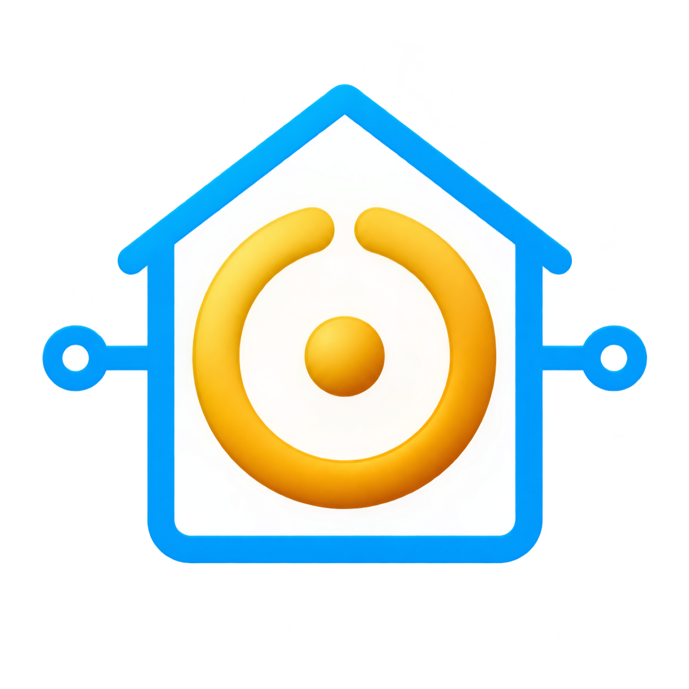
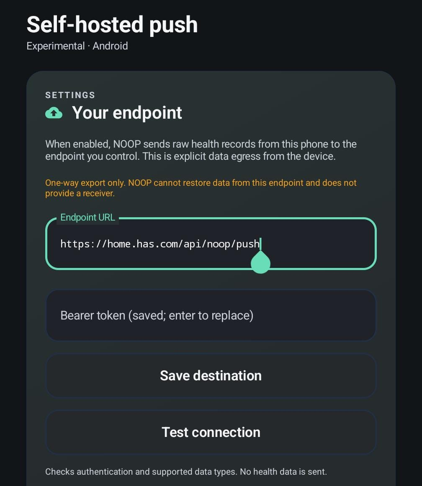

# NOOP Push for Home Assistant



[Support this project](https://buymeacoffee.com/timgerr)

NOOP Push receives health data from the [NOOP app](https://github.com/ryanbr/noop)
and creates Home Assistant sensors for heart rate, steps, sleep, recovery,
strain, calories, battery, and other supported metrics.

- Data is sent one way from the app to Home Assistant.
- The receiver uses a bearer token for authentication.
- Use an HTTPS address that the phone can reach.
- The integration stores the latest received data in Home Assistant.

## Installation

### 1. Add the repository to HACS

1. Open **HACS → Integrations**.
2. Select the **⋮** menu in the top-right corner.
3. Select **Custom repositories**.
4. Enter:

   ```text
   https://github.com/MLNGE/NOOP-push
   ```

5. Select **Integration** as the category.
6. Click **Add**.

### 2. Install the integration

1. Search for **NOOP Push** in HACS.
2. Open it and click **Download**.
3. Restart Home Assistant.
4. Go to **Settings → Devices & services → Add integration**.
5. Search for **NOOP Push** and complete the setup.
6. Choose the data streams and create an authentication token.

Use the same authentication token in Home Assistant and the NOOP app.

### 3. Configure local push in NOOP

In the NOOP app, open **Self-hosted push** and enter:

- Endpoint URL: `https://your-home-assistant.example.com/api/noop/push`
- Authentication token: use the same token configured in Home Assistant

The endpoint must end with `/api/noop/push`.



Tap **Save destination**, then **Test connection**. After the connection
succeeds, enable local push in the app.

The entities will appear under the NOOP Push device in Home Assistant as data
arrives.
